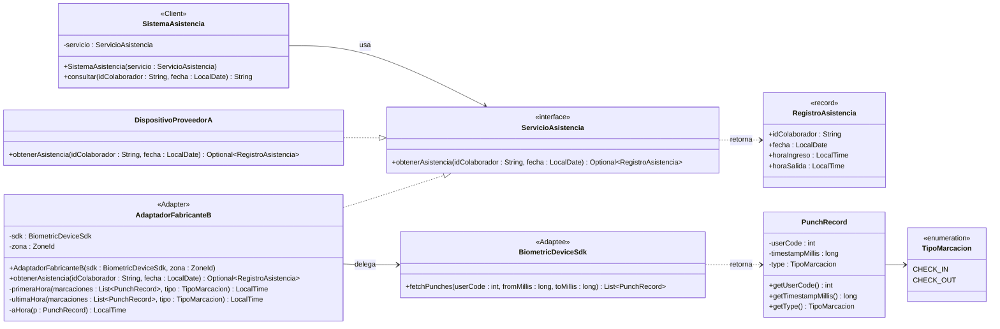

# Escenario 02 – Integración de dispositivos biométricos

## 1. Problema estructural
El sistema institucional depende de un contrato estable (`ServicioAsistencia`) que devuelve un registro diario normalizado. El nuevo fabricante entrega una biblioteca **no modificable** con una interfaz **incompatible**:

| Aspecto | Contrato institucional | SDK Fabricante B |
|---|---|---|
| Operación | `obtenerAsistencia(id, fecha)` | `fetchPunches(userCode, fromMillis, toMillis)` |
| Identificador | `String` | `int` |
| Fecha | `LocalDate` | rango epoch en milisegundos |
| Resultado | un `RegistroAsistencia` (ingreso/salida) | `List<PunchRecord>` (marcaciones sueltas) |

No se puede cambiar el cliente (generaría dependencia del proveedor) ni el SDK (se perdería compatibilidad con versiones futuras). Hacen falta clases que conviertan una interfaz en la otra.

## 2. Patrón seleccionado: **Adapter (de objetos)**
**Justificación**
- Su propósito es justamente convertir la interfaz de una clase en otra que el cliente espera, sin modificar a ninguna de las dos.
- **Adapter de objetos (composición)** en lugar de adapter de clases (herencia): Java no admite herencia múltiple de clases, el SDK puede ser `final` o cambiar en una versión futura, y la composición reduce el acoplamiento.
- **Extensibilidad (OCP):** un proveedor nuevo solo requiere un adaptador nuevo (`AdaptadorFabricanteC`). El cliente no cambia.
- Descartados: *Facade* (simplifica un subsistema, pero no lo adapta a un contrato que ya existe), *Bridge* (se diseña antes de tener las implementaciones; aquí la incompatibilidad ya está dada).

## 3. Diagrama de clases UML



## 4. Participantes del patrón

| Rol (GoF) | Clase | Responsabilidad |
|---|---|---|
| **Client** | `SistemaAsistencia` | Consulta la asistencia usando solo el contrato institucional. |
| **Target** | `ServicioAsistencia` (+ `RegistroAsistencia`) | Contrato estable y estructura normalizada. |
| **Adaptee** | `BiometricDeviceSdk` (+ `PunchRecord`, `TipoMarcacion`) | Biblioteca del fabricante B, incompatible y no modificable. |
| **Adapter** | `AdaptadorFabricanteB` | Implementa el Target, compone al Adaptee y traduce parámetros y resultados. |
| Implementación nativa del Target | `DispositivoProveedorA` | Proveedor histórico. Ya cumple el contrato y no necesita adaptador. |

**Transformaciones del Adapter**
1. `String id` → `int userCode`.
2. `LocalDate fecha` → rango `[inicio del día, inicio del día siguiente)` en epoch ms, según `ZoneId`.
3. `List<PunchRecord>` → `RegistroAsistencia`: el ingreso es el `CHECK_IN` más temprano y la salida el `CHECK_OUT` más tardío.
4. Si no hay marcaciones → `Optional.empty()`.

## 5. Implementación (Java 17)

```
src/
├── universidad/
│   ├── Main.java
│   ├── asistencia/   ServicioAsistencia, RegistroAsistencia, SistemaAsistencia
│   └── dispositivos/ DispositivoProveedorA, AdaptadorFabricanteB
└── com/fabricanteb/sdk/  BiometricDeviceSdk, PunchRecord, TipoMarcacion   (biblioteca externa simulada)
```

Ejecución:
```bash
javac -d out $(find src -name "*.java")
java -cp out universidad.Main
```
Salida:
```
Proveedor A : 1001 | 2026-10-15 | ingreso 08:00 | salida 17:00
Fabricante B: 1001 | 2026-10-15 | ingreso 07:52 | salida 16:48
Fabricante B: 2002 | 2026-10-15 | sin registros
```

## 6. Correspondencia UML ↔ código
- Cada clase, atributo y método del diagrama existe en el código con el mismo nombre y la misma firma.
- `..|>` del diagrama = `implements ServicioAsistencia` en `DispositivoProveedorA` y `AdaptadorFabricanteB`.
- `AdaptadorFabricanteB --> BiometricDeviceSdk` = atributo `private final BiometricDeviceSdk sdk` (composición, inyectado por constructor).
- `SistemaAsistencia --> ServicioAsistencia` = atributo `private final ServicioAsistencia servicio`. El cliente no importa nada de `com.fabricanteb.sdk`.

## 7. Uso crítico de IA

**Prompt principal**
> "Actúa como Arquitecto de Patrones de diseño de software. Para el Escenario 02 (sistema de asistencia universitario que debe integrar dispositivos biométricos de un nuevo fabricante con biblioteca no modificable e interfaz distinta): identifica el problema estructural, selecciona y justifica el patrón estructural, elabora el diagrama UML, identifica los participantes, implementa la solución en Java y mantén la correspondencia entre UML y código."

**Recomendación aceptada**
- *Recomendación:* usar **Adapter de objetos (composición)** en lugar de Adapter de clases (herencia del SDK).
- *Justificación:* Java no permite heredar de dos clases, el SDK puede ser `final` o cambiar entre versiones, y la composición permite inyectar el SDK (incluso un *mock* en pruebas). Además mantiene al cliente totalmente aislado del proveedor, que es lo que pide el escenario.

**Recomendación modificada**
- *Recomendación original de la IA:* que el adaptador devolviera `null` cuando el dispositivo no tuviera marcaciones, y agregar además una *Abstract Factory* / registro de proveedores para elegir el dispositivo por configuración.
- *Modificación:* se reemplazó `null` por `Optional<RegistroAsistencia>` en el contrato, y se **rechazó** la fábrica.
- *Justificación:* `Optional` hace explícita en el contrato la ausencia de registros y evita `NullPointerException` en el cliente. La fábrica resuelve un problema de **creación**, no estructural. Está fuera del alcance del escenario y añadiría complejidad que no se necesita: con el Adapter basta para incorporar proveedores futuros (un adaptador por proveedor).
